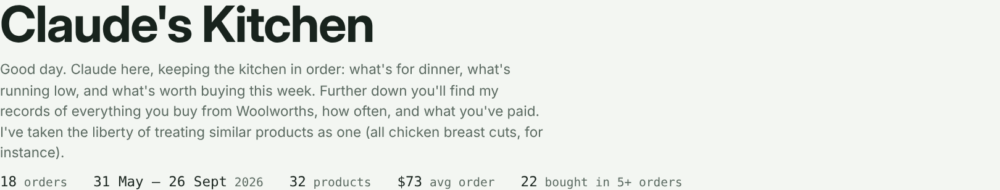
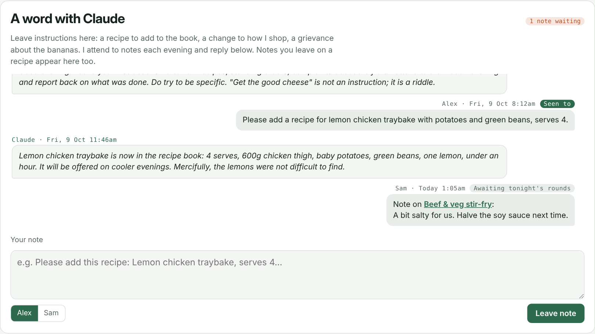
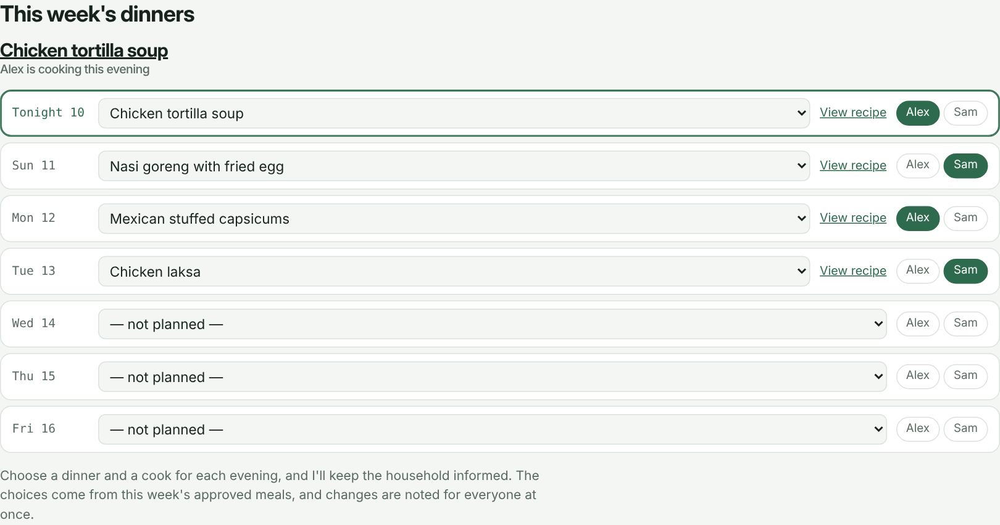
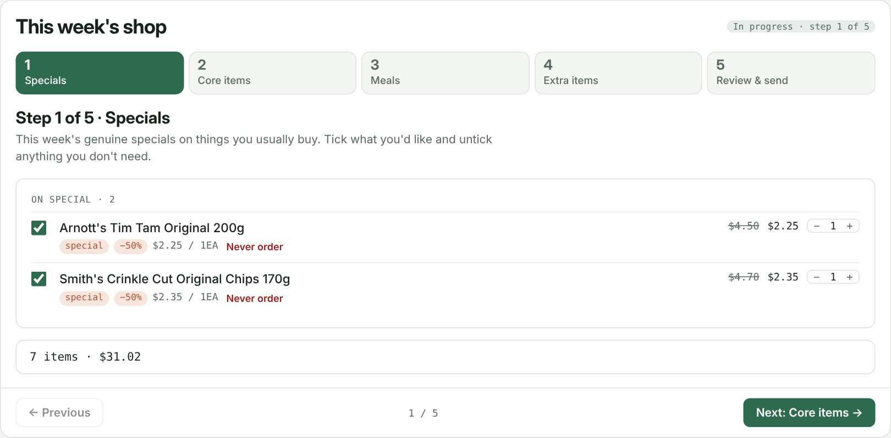
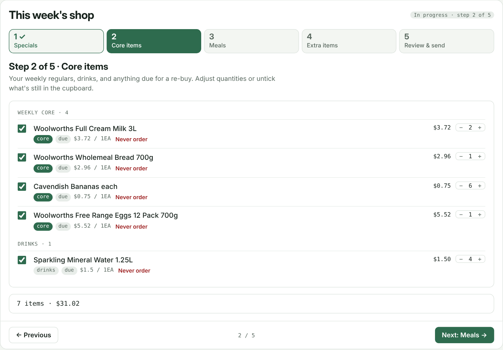
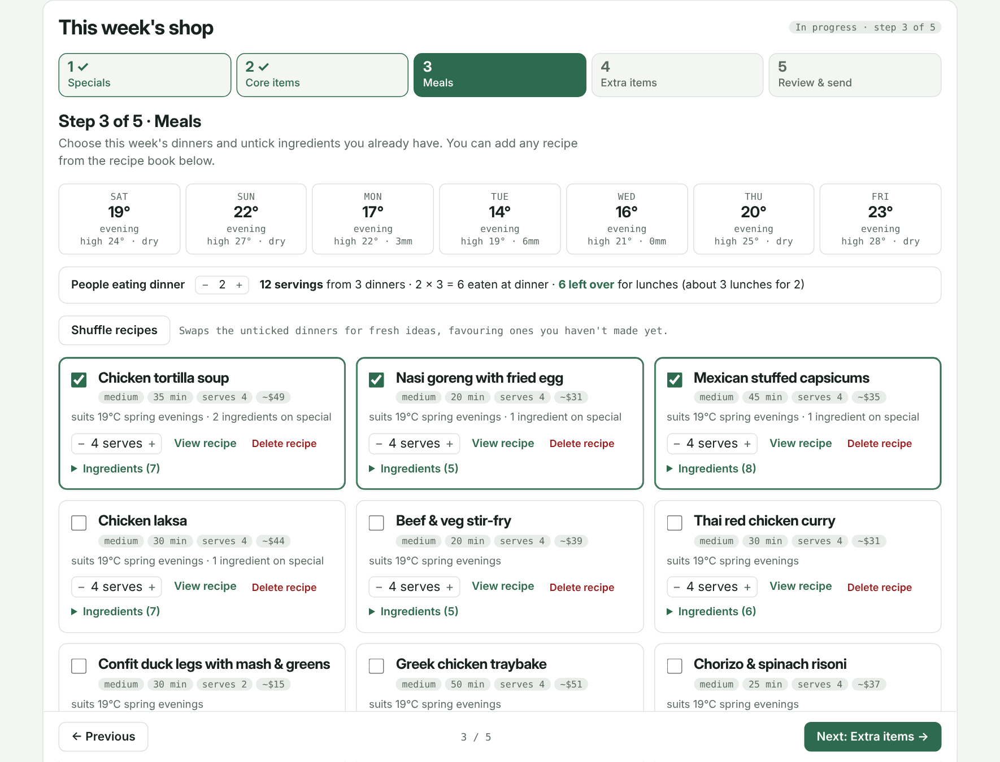
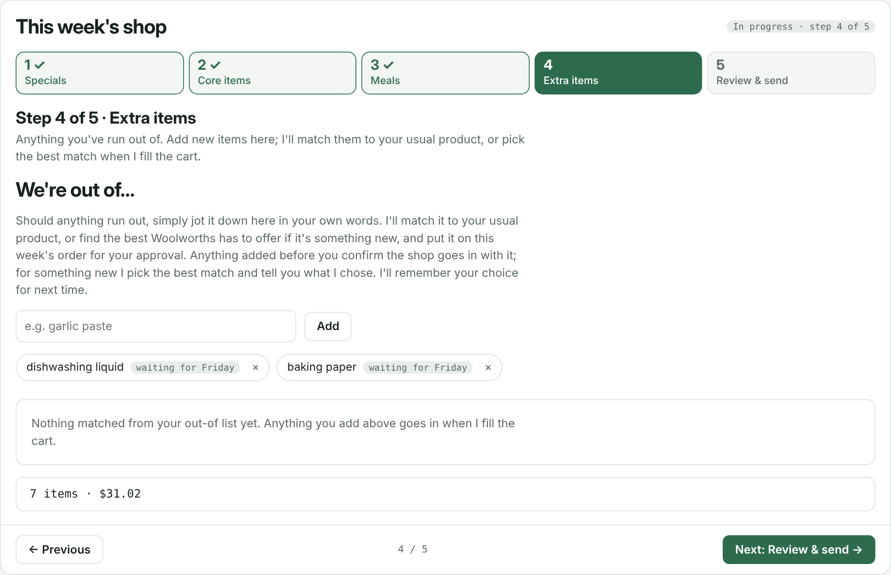
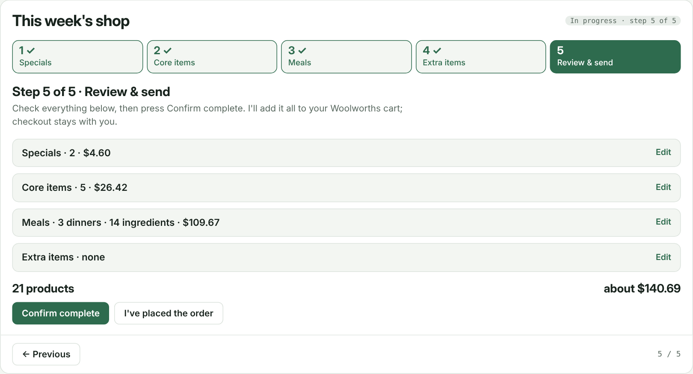
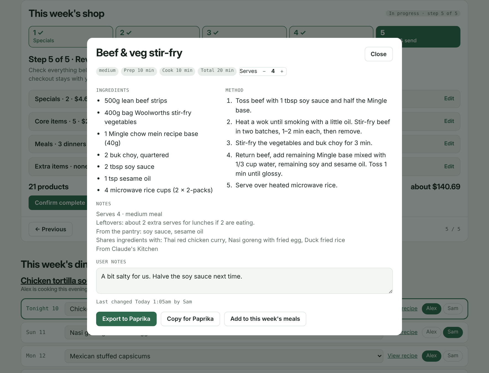

# Claude's Kitchen

A weekly Woolworths (Australia) grocery and meal-planning assistant, packaged as a plugin for the Claude desktop app.

Claude acts as your household's butler. It learns what you buy from your own order history, checks prices and genuine specials each week, suggests dinners that suit the week's weather and season, takes notes from you on a private page, and adds to your Woolworths cart **only what you confirm**. Checkout and payment are always yours.

> **Unofficial project.** This is a community plugin. It is not made, endorsed or supported by Anthropic or Woolworths.
>
> **Unofficial interface.** Claude talks to Woolworths through the same web interface your browser uses while you're signed in. It is not an official or supported API: it may change or break without notice, and you use it at your own risk and subject to Woolworths' terms. Claude never checks out, pays, enters passwords or changes account settings, and stops if Woolworths asks for sign-in or a CAPTCHA.

## Features at a glance

**Shopping**
- Learns your usual products, quantities and how often you buy them from your past orders, grouping similar products together.
- Builds a weekly list of core items, things due for a re-buy, and genuine specials. Price history is used to spot items that are "on special" almost every week.
- Suggests stock-ups on long-life items when the discount is deep, and holds back items you're overstocked on.
- "We're out of…" list: type items in your own words and Claude matches them to your usual product or the best option on Woolworths.
- Never order list, brand alternatives, "buy whichever is cheaper" and rotating products.
- Reads each delivered order back from your Woolworths account, so you don't need to keep saving invoices, and starts the next week's list automatically.

**Meals**
- Twelve dinner ideas each week, matched to the evening forecast and the season, with five pre-picked.
- Adjustable serves, optional vegetables (remembered), shuffle for new ideas, and a full recipe book you can add from.
- Favours recipes that use what's already in your pantry and learns which meals your household keeps choosing.
- Dinner schedule for the next seven nights, with who's cooking.
- Paprika export, recipe photos, and a **User notes** box on every recipe.

**Your private page**
- A five-step weekly flow: Specials → Core items → Meals → Extra items → Review & send.
- **Confirm complete** fills your cart straight away. **I've placed the order** locks the week until the order is read back.
- **A word with Claude**: leave notes (a new recipe, a change of rules, a product nickname) and Claude acts on them each evening and replies.
- Plans around your public holidays and any events you follow (for example a sports season), with a no-spoilers mode for people who watch later.

**Safety**
- Nothing reaches your cart until you confirm it, and Claude never checks out, pays or touches account settings.
- All your data stays in your own folder and your own private page.

---

## Screenshots

All screenshots use a made-up demo household (Alex and Sam) with sample orders and prices.

| | |
|---|---|
| **Your page and order history**  | **A word with Claude**: notes, replies and recipe notes  |
| **This week's dinners** and who's cooking  | **Step 1 · Specials**: genuine specials on things you buy  |
| **Step 2 · Core items**: weekly regulars and re-buys  | **Step 3 · Meals**: forecast-matched dinners  |
| **Step 4 · Extra items**: "We're out of…"  | **Step 5 · Review & send**  |
| **Recipe view** with serves and User notes  | |

---

## 1. What you need

| Requirement | Why |
|---|---|
| A Claude plan with **Cowork** and the **Claude desktop app** | Runs Claude and the scheduled tasks |
| A **folder on your computer** linked to the task | Holds your history, settings and recipes |
| **Claude in Chrome**, signed in to woolworths.com.au | Price checks, reading orders, adding approved items |
| **4 or more Woolworths tax-invoice PDFs** (10+ is better) | Your starting purchase history |
| **Python 3** on your computer | Runs the engine (setup installs `pdfplumber` if missing) |

To get invoices: woolworths.com.au → **My Account → Orders** → **Download** on each tax invoice. Save them all into one folder.

---

## 2. Setup process

Setup takes about 30–45 minutes the first time, mostly while Claude reads your orders and prices. Work through these steps in order.

### Step 1: Gather your order history
1. Sign in at woolworths.com.au and go to **My Account → Orders**.
2. Download the tax invoice PDF for at least 4 past orders (10 or more gives better results).
3. Put them all in one new folder on your computer, for example `Documents/Kitchen`. This folder becomes Claude's home for your history, settings and recipes.

### Step 2: Check the requirements
- The **Claude desktop app** on the computer that will run the weekly jobs, signed in to a plan that includes Cowork and scheduled tasks.
- **Python 3** installed on that computer. Setup installs the PDF reader it needs.
- **Google Chrome** with the **Claude in Chrome** extension installed and connected, and you signed in to woolworths.com.au in that Chrome.
- The **Claude Code Remote** connector enabled in your Claude settings. The page uses it to start the cart run when you press **Confirm complete**. Without it everything still works, but you'll start the cart run by saying "push to cart" in chat.

### Step 3: Install the plugin
1. Download `claudes-kitchen.plugin` from this repository's **Releases** page, or zip the repository's contents yourself and rename the file to end in `.plugin`.
2. In the Claude desktop app, open the file (or drag it into a chat) and press **Install**.

### Step 4: Start setup on the right computer
1. In the desktop app, start a new task with your computer linked. Use the computer that will be on in the evenings: the scheduled jobs run there.
2. Say **"set up Claude's Kitchen"**.
3. When asked, connect the folder from Step 1. Approve the folder access prompt.

### Step 5: Let Claude read your history
Claude copies its engine and starter files into a `smart/` subfolder (nothing you already have is overwritten), reads your invoices, groups similar products (for example, all chicken breast cuts count as one item) and shows your top 20 items. If many items land in a group called "Other", Claude adds grouping rules and reads them again.

### Step 6: Answer the setup questions
Claude asks a few short rounds of questions:

| Question | What it's used for |
|---|---|
| **Helper's name** | "Claude" by default; pick any name. Used on the page and in messages. |
| **Household members** | First names of the people who cook. Used for the dinner schedule, the note box and how you're addressed. |
| **City and timezone** | The weather forecast that shapes meal ideas, and when scheduled jobs run. Only the city is stored. |
| **Public holidays** | Which state or region's public and bank holidays apply, so the weekly list can allow for them (order early, an extra dinner at home). |
| **Events you follow** | Any sports seasons or other regular events you plan meals around, whether you watch live or delayed, and which day you'd like a weekly preview (Thursday by default). If you watch delayed, Claude never mentions results. Answer "none" to skip. |
| **Core items** | Things that go on the list every week, with quantities (milk, eggs, bread…). |
| **Never buy** | Products or groups Claude should never suggest. |
| **Recipes** | Keep all the starter dinners or remove any you don't eat. You can add your own later. |

### Step 7: First price check and your page
1. Make sure Chrome is open and signed in to Woolworths. Claude looks up current prices and your cart. This is read-only: nothing is added to your cart during setup.
2. Claude creates the on-request cart task, then builds and publishes your private page, **<name>'s Kitchen**, on claude.ai. Only you can open it unless you share it.
3. When asked, allow the page its permissions: saving data, downloads, photos, and starting your cart task.
4. Claude fills the page with your first list, your holidays and events, and a welcome note.

### Step 8: Approve the scheduled tasks
Claude creates these in your timezone, each tied to your computer and folder. You can change the times before or after:

| When | What | Changes your cart? |
|---|---|---|
| Friday ~6am | Weekly list: staples, genuine specials, 12 dinner ideas (or a specials refresh of a list you haven't finished) | No |
| When you press **Confirm complete** | Adds everything you confirmed to your cart | Yes, confirmed items only |
| Every evening ~7:50pm | Reads your delivered order from the website, then starts next week's list | No |
| Every night ~9:45pm | Reads your notes, does what you asked, and replies on the page | No |
| Every night ~10:20pm | Tidies the "In the pantry…" list | No |

Claude tells you whether each task runs automatically or asks for approval each time. Tasks that ask for approval will pause if nobody is there to approve, so you may want to switch them to automatic approval in each task's settings. Scheduled jobs only run while your computer is on with the Claude desktop app open.

### Step 9: Check it works
1. Open your page and leave a test note in **A word with Claude** (for example "Please add my favourite pasta bake"). It should get a reply after the evening run.
2. Work through the five steps of **This week's shop** and press **Confirm complete**. Your cart should fill within a few minutes, and you'll get a notification.
3. Check out on Woolworths as usual, then press **I've placed the order** on the page.

After setup you don't need to save invoice PDFs any more. Claude reads each delivered order from your Woolworths account. Saving a PDF still works and replaces the website copy for that order.

---

## 3. Setup at a glance

| Step | You do | Claude does |
|---|---|---|
| 1–3 | Download invoices, check requirements, install the plugin | — |
| 4 | Start a task on your computer, say "set up Claude's Kitchen", connect the folder | Copies its files into `smart/` |
| 5 | — | Reads your history and shows your top items |
| 6 | Answer the questions | Saves your settings, holidays and events |
| 7 | Sign in to Woolworths in Chrome, allow page permissions | Prices your list and publishes your page |
| 8 | Approve the scheduled tasks | Sets up the weekly, nightly and cart jobs |
| 9 | Try a note and a shop | Replies, fills the cart when you confirm |

---

## 4. Using Claude each week

Your page is ready from Friday morning (or straight after your last order arrives). Work through it whenever suits; there's no fixed cart day.

### A word with Claude
At the top of the page. Leave Claude a note in plain words: a new recipe to add, a change to how he shops, a product nickname, a complaint about the bananas. Choose who it's from and press **Leave note**. Each evening Claude does what you asked and replies in the same box, saying exactly what he changed. The box keeps a fixed height and scrolls. On the preview day (Thursday by default) he also mentions any public holiday coming up and what's on in the events you follow, never results if you watch delayed.

### This week's dinners
Tonight's dinner and who's cooking, then the next six nights. Pick a dinner for each night from this week's meals (or Leftovers / Eating out / Takeaway) and tap who's cooking. Each night links to its recipe.

### This week's shop: five steps
1. **Specials**: genuine specials on things you usually buy. Claude checks price history, so an item that's "on special" most weeks isn't treated as a special.
2. **Core items**: weekly regulars, drinks and anything due for a re-buy.
3. **Meals**: twelve dinners matched to the week's evening temperatures and the season, with 5 pre-picked. Adjust serves, untick ingredients you have, **Shuffle recipes** for new ideas, or add any recipe from the book.
4. **Extra items**: the "We're out of…" list. Type anything in your own words; Claude matches it to your usual product or the best option on Woolworths.
5. **Review & send**: check the lot and press **Confirm complete**. Claude adds it all to your Woolworths cart straight away (your computer needs to be on). **Reopen to make changes** if you need to.

Once you've checked out on Woolworths, press **I've placed the order** (two taps). The week locks until Claude reads the order back from your account, then next week's list starts automatically. Pressed it by mistake? Use **Undo**.

### I have extra…
Overstocked? Enter how many you have ("4 shampoo"). Claude holds the item back until you're down to about one usual buy's worth, then puts it back on the list when about 10 days' supply is left.

### In the pantry…
Everyday ingredients you keep on hand: sauces, spices, oils, stocks. Claude favours recipes that use them and leaves them out of the meal cost. He tidies duplicates and typos each night.

### Never order
Any product line has a **Never order** link. Claude won't suggest it again (and skips it in the cart run) until you undo it.

### Recipes
Browse all recipes on the page and filter them. Open one to see ingredients and method, change the serves, tick optional vegetables (remembered), add a photo, add it to this week's meals, or **Export to Paprika**. Each recipe has a **User notes** box: write something like "too salty, halve the soy" and Claude makes the change that evening, marks your note **[resolved]** so it's never done twice, and lists the change in the note box. **Delete recipe** (two taps) removes one; Claude keeps a backup.

### Talking to Claude
You can ask in chat at any time, for example:
- "Run the weekly proposal now" (builds a proposal; never touches the cart)
- "Add my approved items to the cart"
- "Never suggest X again" / "Always get 2 of Y"
- "I have 6 toilet rolls spare"
- "Add a recipe for …"
- "Push to cart" (if the page couldn't reach Claude)

---

## 5. Customisation

Settings live in your folder, mainly `smart/rules.json`. The easiest way to change anything is to ask Claude in chat ("make milk a core item, 2 each week"). If you edit the files yourself, keep them valid JSON, and changes apply from the next run.

### Things most households should review in the first few weeks

| What | Where | Example |
|---|---|---|
| **Core items** (every week, fixed quantity) | `rules.json → core` | `"Milk 3L": 2, "Eggs": 1` |
| **Never buy** | `rules.json → never` | `["Soft drink cans"]` |
| **Brand alternatives** (fallbacks if your usual is out) | `rules.json → alternatives` | `"Coffee": ["Brand B 200g", "Brand C 250g"]` |
| **Buy whichever is cheaper** | `rules.json → cheapest` (plus `alternatives`) | `"cheapest": ["Sparkling water"]` |
| **Rotate between products** (variety week to week) | `rules.json → rotate` | `"Yoghurt": ["Flavour A", "Flavour B"]` |
| **Fixed buying cycle** (e.g. every 8 days) | `staples_policy → cycle_days` | `"Soda syrup": 8` |
| **Drinks** (suggested when due or on special) | `staples_policy → drink_groups`, `drink_patterns` | add `"kombucha"` |
| **Product grouping** (what counts as the same item) | `item_groups.csv` | `soda water\|mineral water,Sparkling water` |

### Specials and stock-ups

| Setting | Default | Meaning |
|---|---|---|
| `min_special_pct` | 20 | Minimum discount to count as a special |
| `stockup_special_pct` | 35 | Discount at which Claude suggests stocking up on long-life items |
| `stockup_weeks` | 6 | How many weeks' supply a stock-up covers |
| `stockup_max_multiple` | 4 | Never more than this × your usual quantity |
| `price_jump_pct` | 50 | Flags and unticks items this much above their usual price |
| `cheaper_per_unit_pct` | 10 | Flags an alternative this much cheaper per unit |
| `stock_buffer_days` | 10 | Days of supply left when an overstocked item comes back |

Household members for the dinner schedule: `rules.json → household_members` (e.g. `["Sam", "Alex"]`).

### Meals
- **Weather fit:** `rules.json → meal_weather`. Temperature bands for hearty, medium and light meals, the hot-day cap and the rain bonus. Raise the hearty thresholds if you like hearty food in warmer weather.
- **Seasons:** `rules.json → meal_seasons`. Set up for the Southern Hemisphere. **In the Northern Hemisphere, swap the months** (summer = Jun–Aug, etc.).
- **Dinner-only groups:** `rules.json → dinner_groups`. Items only bought for recipes, never as staples (e.g. mince, fresh herbs).
- **Recipes:** `smart/recipes.json`. Each ingredient is either a product group from your history (`g`, with a fallback product `fb`) or a specific product (`p`). Ask Claude to add, edit or remove recipes rather than editing by hand.

### Personality
Claude is written as a courteous, discreet household butler with a dry sense of humour, who very occasionally gets into a harmless tizz. Change the **Personality** paragraph at the top of `skills/kitchen-weekly/references/runbook.md` (or just ask) for a different voice.

### Schedule and identity
- **Times and days:** change the scheduled tasks in Cowork, or ask Claude ("move the weekly list to Thursday evening").
- **Holidays and events:** stored on your page (`settings/holidays`, `settings/events`). Ask Claude to add a series, drop one, change the preview day, or switch spoilers on or off.
- **Name:** `rules.json → household_name`. Ask Claude to rename the page as well.
- **Location:** `rules.json → timezone` and `location`. Update these if you move.

### Things Claude learns on its own
- Items you untick, or remove before checkout, score lower next time (`smart/learned.json`).
- Your out-of picks are remembered (`smart/outof_map.json`).
- Meals cooked in the last two weeks drop down the list (`smart/meal_history.json`).

To reset what Claude has learned, ask Claude to clear these files. Your purchase history is not affected.

---

## 6. Privacy

- Everything stays in your own folder and your own private page. This plugin contains no personal data, invoices or purchase history.
- When reading orders from the website, Claude keeps only the grocery lines: product, quantity, supplied, price. It saves no address, payment or rewards card details.
- Your location is stored only as a city, its coordinates and a timezone, and is used for the weather forecast (open-meteo.com).
- Notes you leave for Claude, your holidays and your events are stored only on your private page.

---

## 7. Troubleshooting

| Problem | Fix |
|---|---|
| "Signed out" or CAPTCHA reported | Sign in to Woolworths in Chrome, then ask Claude to re-run. |
| Scheduled run didn't happen | Your computer must be on with the Claude desktop app running and Chrome open. |
| An item is grouped wrongly | Ask Claude to fix the grouping, or add a line to `item_groups.csv`. |
| No order found after delivery | Claude checks every evening; you can also save the invoice PDF into your folder. |
| Confirm complete says it couldn't reach Claude | Make sure your computer is on with the Claude desktop app open, then press **Send to Claude again**, or say "push to cart" in chat. |
| Something changed on the Woolworths site | The unofficial interface may have changed. Save invoice PDFs and add items by hand until it's fixed. |

---

## 8. Files

- `engine/`: invoice reader, ranking, weekly engine (`friday.py`), page builder (`build_page.py`), website order reader (`order_extract.js`), page template
- `starter/`: starter rules, product groups and original starter recipes
- `skills/kitchen-setup`: first-time setup
- `skills/kitchen-weekly`: weekly runs (full runbook in `references/runbook.md`)
- `docs/screenshots`: README images only (not part of the installed plugin)

---

## License

Copyright © 2026 Chigerama. Released under the [MIT License](LICENSE).
